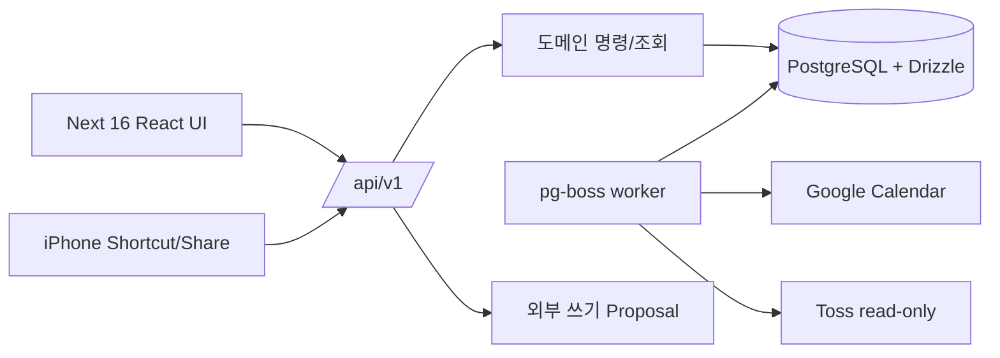

# 02. 아키텍처

경계는 UI(표현), API(인증·입력·idempotency), domain(계산·전이), persistence(Drizzle), integration(외부 OAuth/API), worker(동기화·백업)로 분리한다. Better Auth는 소유자 단일 계정만 허용하고, `owner:create`가 최초 계정을 만든다. 공개 signup은 없다.

모든 변경은 typed `Command`로 유입된다. `version`이 있는 자원은 expected version 불일치 시 409 conflict를 돌려준다. `idempotencyKey`로 재시도 쓰기를 중복 실행하지 않는다. 이 경계는 DR-001/NFR-002 → INT-API-001, TYPE-CONTRACT-001 (planned)으로 추적한다.
